# Secure Pipeline Demo: DevSecOps with GitHub Actions


A hands-on project showing how application security checks can be built directly into a CI/CD pipeline: **SAST, dependency scanning, secrets detection, a custom detection rule, automated triage, and a quality gate**, followed by remediation and verification.

> **Disclaimer:** This is a personal learning lab. The application was deliberately vulnerable, and every secret in this repo is fake. Nothing here comes from a real client or employer.

---

## Table of Contents

1. [Project Summary](#project-summary)
2. [Skills Demonstrated](#skills-demonstrated)
3. [Architecture](#architecture)
4. [Tools Used](#tools-used)
5. [Repository Structure](#repository-structure)
6. [Walkthrough](#walkthrough)
7. [Findings Summary](#findings-summary)
8. [Problems I Faced and How I Solved Them](#problems-i-faced-and-how-i-solved-them)
9. [Design Decisions](#design-decisions)
10. [Key Lessons](#key-lessons)
11. [Limitations](#limitations)
12. [Next Steps](#next-steps)
13. [How to Reproduce](#how-to-reproduce)
14. [Glossary](#glossary)

---

## Project Summary

In a real engineering team, code ships many times a day and a security team cannot review every change by hand. The usual answer is to put automated checks **inside the delivery pipeline**, so every push is scanned within about 30 seconds. This is called "shifting left".

My background is manual security testing (web, API, mobile and network assessments). I built this project to get hands-on with the **automation side** of application security: wiring scanners into CI/CD, tuning them, triaging their output, and enforcing a policy when serious issues appear.

The workflow I built and practiced:

**Find → Triage → Gate → Fix → Verify**

---

## Skills Demonstrated

| Area | What I did in this project |
|---|---|
| CI/CD security | Built a GitHub Actions workflow that runs three scanners in parallel on every push and pull request |
| SAST | Ran Semgrep with the built-in Python ruleset and wrote my own custom rule |
| SCA / dependency scanning | Used Trivy to find known CVEs in third-party libraries |
| Secrets detection | Used Gitleaks and verified it against known-bad input |
| Custom rule writing | Semgrep rule using pattern matching plus a metavariable regex, mapped to CWE and OWASP |
| Finding triage | Python script that parses scanner JSON, maps severities, extracts CWE IDs and supports a documented false-positive list |
| Automation / scripting | Triage summary published to the run page and saved as a build artifact |
| Policy enforcement | Quality gate that fails the build on HIGH findings but not on MEDIUM ones |
| Remediation | Parameterized queries, removing debug mode, environment-based secrets, dependency upgrades |
| Verification | Confirmed each fix by re-running the pipeline and reading the scanner logs |
| Supply chain awareness | Investigated a real tag-compromise incident affecting one of the tools I used |
| Standards mapping | Findings mapped to OWASP Top 10 and CWE |

---

## Architecture

```
 git push / pull request
          |
          v
 +------------------------ GitHub Actions ------------------------+
 |                                                                |
 |   +------------+    +--------------+    +------------------+   |
 |   |  Semgrep   |    |   Gitleaks   |    |      Trivy       |   |
 |   |   (SAST)   |    |  (secrets)   |    |  (dependencies)  |   |
 |   +-----+------+    +--------------+    +------------------+   |
 |         |                                                      |
 |         v                                                      |
 |   Custom rule --> Triage script --> Save artifacts --> Gate    |
 |   (rules/)        (scripts/)        (JSON + summary)   (fail   |
 |                                                         on HIGH)|
 +----------------------------------------------------------------+
```

The three scanners run in parallel. Inside the Semgrep job, steps run in order: scan, triage, save results, then the gate. The gate is last on purpose, so reports are saved even when the build is blocked.

---

## Tools Used

All tools are free and open source.

| Tool | Type | What it finds |
|---|---|---|
| [Semgrep](https://semgrep.dev) | SAST | Vulnerable patterns in source code |
| [Trivy](https://trivy.dev) | SCA | Known CVEs in third-party libraries (also detects secrets) |
| [Gitleaks](https://gitleaks.io) | Secrets scanning | Credentials committed to the repository |
| GitHub Actions | CI/CD | Runs everything automatically |
| Python 3 | Scripting | Result triage and the quality gate |

---

## Repository Structure

```
.
├── app.py                       # Small Flask app (originally vulnerable, now fixed)
├── config.py                    # Config (originally a hardcoded key, now fixed)
├── safe_config.py               # Negative test case for the custom rule
├── requirements.txt             # Dependencies (originally outdated, now upgraded)
├── rules/
│   └── hardcoded-secret.yml     # Custom Semgrep rule
├── scripts/
│   └── triage.py                # Triage and quality gate script
├── screenshots/                 # Evidence referenced in this README
└── .github/workflows/
    └── security.yml             # The pipeline
```

---

## Walkthrough

### Phase 1: A deliberately vulnerable target

I created a small Flask app with planted flaws, so I knew what each scanner *should* find. A controlled target lets me tell whether a tool is working or silently missing things.

| Planted flaw | Where |
|---|---|
| SQL injection (user input concatenated into a query) | `app.py` |
| Flask running with `debug=True` | `app.py` |
| Outdated libraries with known CVEs (Flask 1.1.2, PyYAML 5.3) | `requirements.txt` |
| Hardcoded AWS-format access key (fake) | `config.py` |

The original vulnerable query looked like this:

```python
query = "SELECT * FROM users WHERE name = '" + name + "'"
result = conn.execute(query).fetchall()
```

### Phase 2: The pipeline

A GitHub Actions workflow (`.github/workflows/security.yml`) triggers on every push to `main` and every pull request, and runs three jobs in parallel:

| Job | Tool | Purpose |
|---|---|---|
| SAST with Semgrep | Semgrep | Flaws in our own code |
| Secrets scan with Gitleaks | Gitleaks | Credentials in the repo |
| Dependency scan with Trivy | Trivy | Known CVEs in libraries |

Each catches things the others cannot, which is why all three are needed.

### Phase 3: First scan results

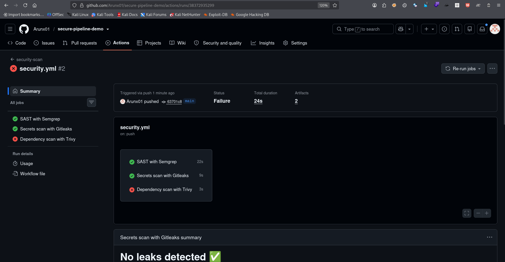

The first run showed Semgrep and Gitleaks green and Trivy red. The red Trivy job was a setup error (see [Problems](#problems-i-faced-and-how-i-solved-them)), not a finding.

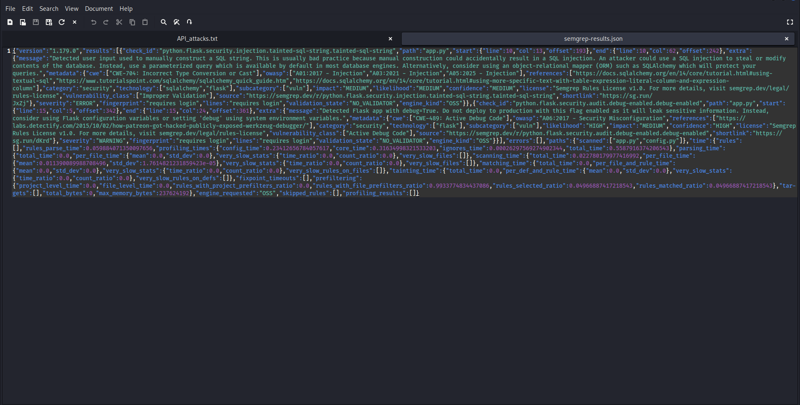

Semgrep's JSON output contained two findings in `app.py`: SQL injection (line 10) and `debug=True` (line 15). It found **nothing** in `config.py`, even though that file held a hardcoded key.

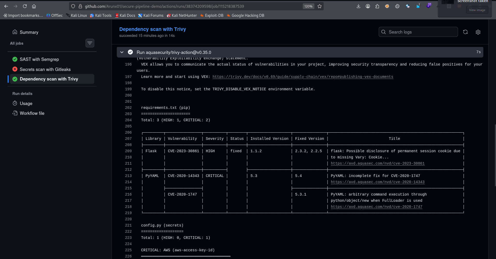

Trivy reported 3 dependency vulnerabilities (1 HIGH, 2 CRITICAL): Flask 1.1.2 (CVE-2023-30861) and PyYAML 5.3 (CVE-2020-14343 and CVE-2020-1747).

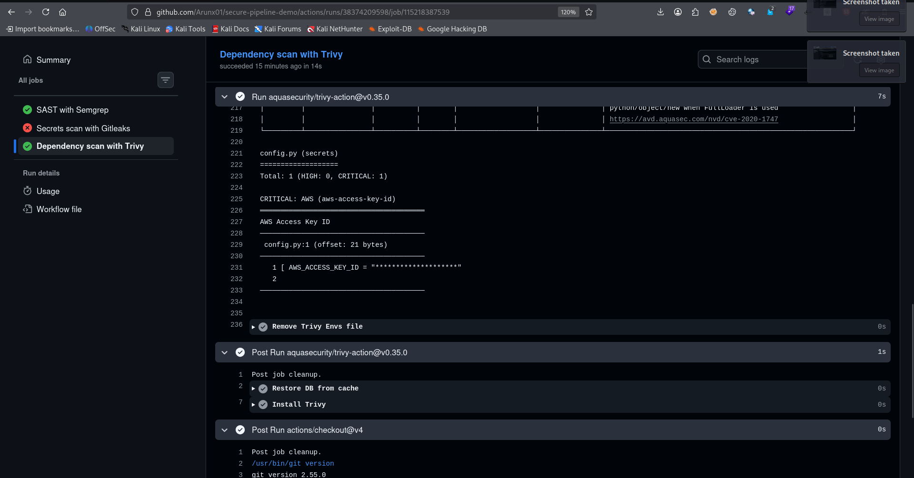

Trivy also flagged the AWS access key in `config.py:1`. The value is masked in the output, which is deliberate: scanner logs should never print secrets in full.

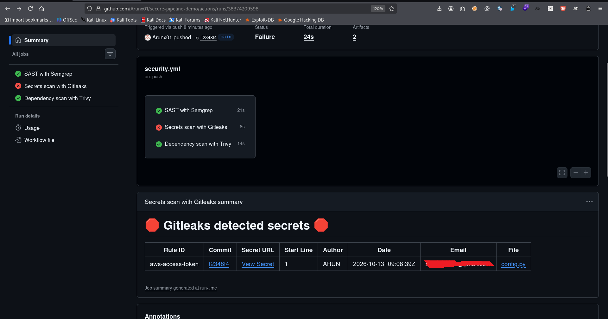

Gitleaks flagged the same key with rule `aws-access-token`. Two tools finding the same issue is normal, and part of triage is deduplicating across tools.

### Phase 4: A custom Semgrep rule

Semgrep's default Python rules missed the hardcoded key. Real codebases always have patterns the default rules do not cover, so I wrote `rules/hardcoded-secret.yml`:

```yaml
rules:
  - id: hardcoded-secret-in-variable
    languages: [python]
    severity: ERROR
    message: >
      Variable "$NAME" looks like a secret but is hardcoded in source.
      Load it from an environment variable or a secrets manager instead.
    patterns:
      - pattern: $NAME = "..."
      - metavariable-regex:
          metavariable: $NAME
          regex: (?i).*(api_?key|secret|password|token|access_key).*
    metadata:
      cwe: "CWE-798: Use of Hard-coded Credentials"
      owasp: "A07:2021 - Identification and Authentication Failures"
```

How it works: `$NAME = "..."` matches any variable assigned a string literal, and the `metavariable-regex` narrows it to names that look like secrets. Without that filter, the rule would flag every string assignment and drown developers in false positives.

**Positive test:** the rule flagged `config.py` line 1.

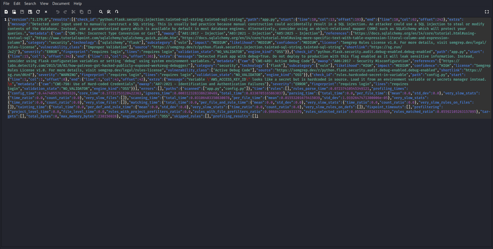

**Negative test:** a rule must also stay quiet on safe code. I added `safe_config.py`, which loads its value from the environment:

```python
import os
API_KEY = os.environ["API_KEY"]
```

Semgrep scanned the file and produced no finding for it, so the rule is precise.

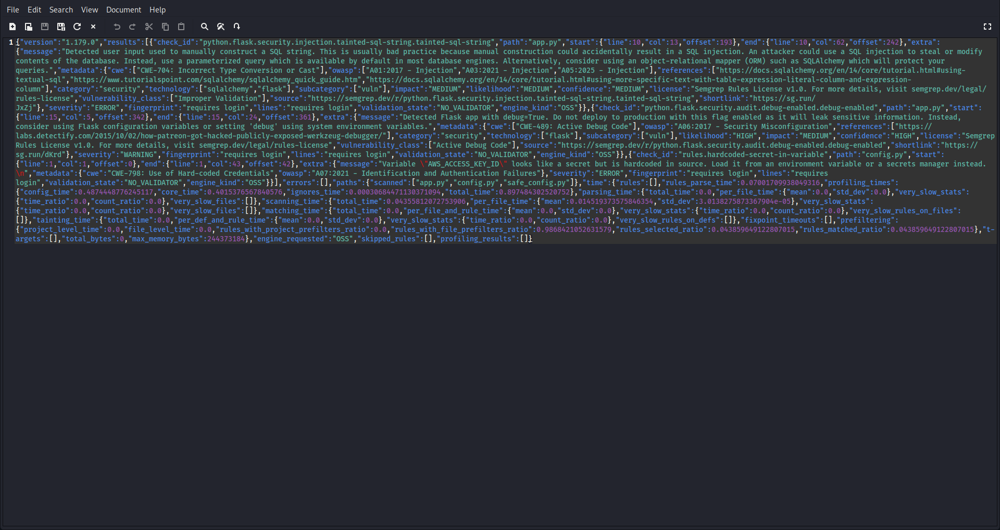

### Phase 5: Automated triage

Raw scanner JSON is accurate but unreadable. `scripts/triage.py` turns it into a short, sorted summary:

- Maps Semgrep's severities (ERROR / WARNING / INFO) to HIGH / MEDIUM / LOW
- Extracts the CWE ID for each finding
- Supports a **false-positive ignore list** and always reports how many findings it suppressed, so nothing is dropped silently
- Prints file, line, CWE and rule for each finding

Output on the vulnerable code:

```
============================================================
TRIAGE SUMMARY: 3 finding(s), 0 ignored as false positive
============================================================

HIGH: 2
  - app.py:10  [CWE-704]  tainted-sql-string
  - config.py:1  [CWE-798]  hardcoded-secret-in-variable

MEDIUM: 1
  - app.py:15  [CWE-489]  debug-enabled

LOW: 0
```

I tested the ignore list by suppressing one finding temporarily (the count dropped from 3 to 2, and the header reported "1 ignored"), then reverted it.

The script runs inside the pipeline after every Semgrep scan. The summary is written to the run's summary page and saved as a build artifact (`triage-summary.txt`) next to the raw JSON.

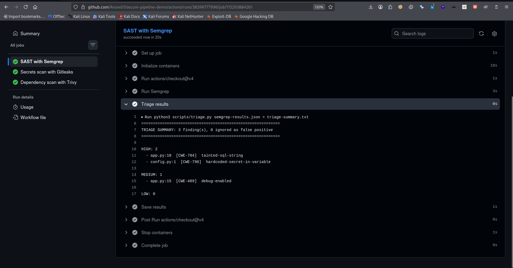

### Phase 6: Quality gate

A pipeline that only reports problems never stops anything. I added a gate: `python3 scripts/triage.py semgrep-results.json --fail-on-high` exits with an error when HIGH findings exist, which fails the build.

- **HIGH findings block** the build.
- **MEDIUM findings are reported but do not block**, to avoid alert fatigue.
- The gate runs **after** the triage and upload steps, so the report is saved even when the gate fails.

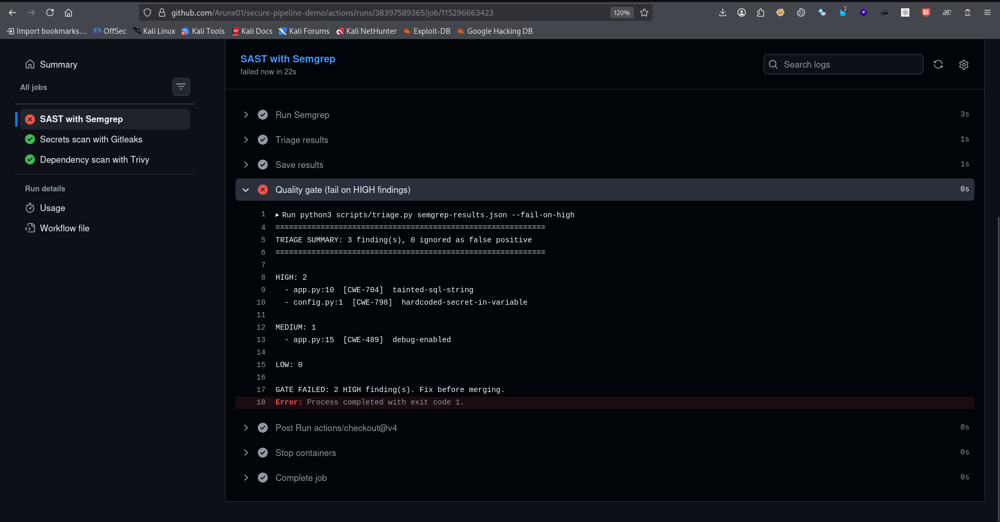

### Phase 7: Remediation

| Issue | Before | After |
|---|---|---|
| SQL injection | String concatenation into the query | Parameterized query with a `?` placeholder |
| `debug=True` | Debug mode enabled | Removed |
| Hardcoded key | Literal value in `config.py` | Read from an environment variable |
| Vulnerable libraries | Flask 1.1.2, PyYAML 5.3 | Flask 3.0.3, PyYAML 6.0.2 |

Fixed query:

```python
result = conn.execute(
    "SELECT * FROM users WHERE name = ?", (name,)
).fetchall()
```

Fixed secret handling:

```python
import os

AWS_ACCESS_KEY_ID = os.environ["AWS_ACCESS_KEY_ID"]
```

### Phase 8: Verification

After the fixes (final run: **#16, "Update requirements.txt"**), I confirmed each result from the scanner logs, not just from the green check.

**Run overview:** all three jobs passed, Semgrep's triage summary reported 0 findings (HIGH, MEDIUM and LOW all 0), so the quality gate passes, and Gitleaks reported no leaks.

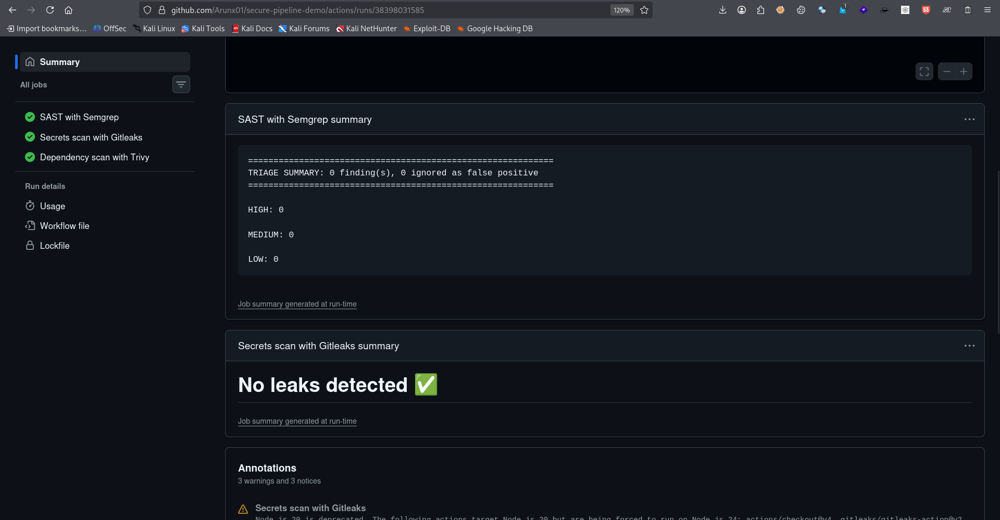

**Trivy log:** the Report Summary shows `requirements.txt` with **0 vulnerabilities**, and the `config.py` row that previously held the secret finding is gone.

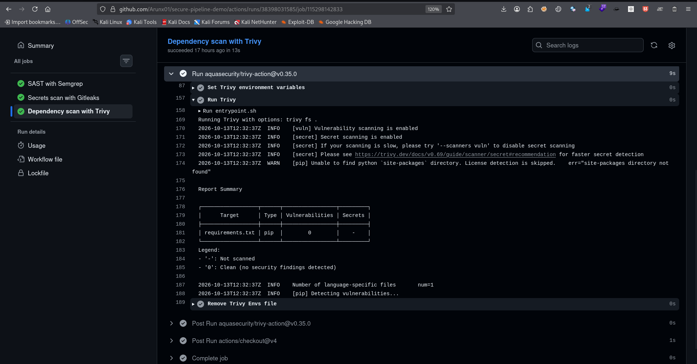

---

## Findings Summary

| # | Finding | Location | Tool | Severity | Standard mapping | Status |
|---|---|---|---|---|---|---|
| 1 | SQL injection via string concatenation | `app.py:10` | Semgrep | HIGH | CWE-89 (Semgrep labels it CWE-704), OWASP A03:2021 | Fixed |
| 2 | Hardcoded credential | `config.py:1` | Semgrep (custom rule), Gitleaks, Trivy | HIGH / CRITICAL | CWE-798, OWASP A07:2021 | Fixed in code (see note) |
| 3 | Flask debug mode enabled | `app.py:15` | Semgrep | MEDIUM | CWE-489, OWASP A05 | Fixed |
| 4 | Flask 1.1.2: session cookie disclosure | `requirements.txt` | Trivy | HIGH | CVE-2023-30861 | Fixed (upgrade) |
| 5 | PyYAML 5.3: arbitrary command execution via `FullLoader` | `requirements.txt` | Trivy | CRITICAL | CVE-2020-1747 | Fixed (upgrade) |
| 6 | PyYAML 5.3: incomplete fix for CVE-2020-1747 | `requirements.txt` | Trivy | CRITICAL | CVE-2020-14343 | Fixed (upgrade) |

**Note on finding 2:** removing a secret from the current code does not remove it from git history. In a real incident the credential would be **rotated** (revoked and reissued), not just deleted. The key in this repo is fake.

---

## Problems I Faced and How I Solved Them

### 1. Trivy failed to start

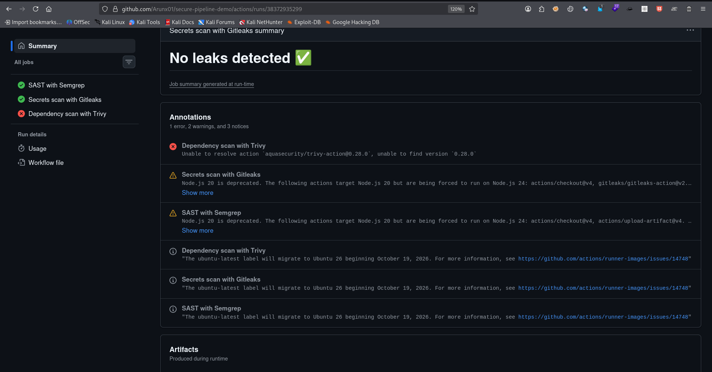

**Symptom:** `Unable to resolve action aquasecurity/trivy-action@0.28.0, unable to find version`.
**Cause:** In March 2026 the `trivy-action` version tags were compromised in a real supply chain attack, and the maintainers restored safe versions with a `v` prefix.
**Fix:** Researched the incident and pinned the action to `v0.35.0`, the version the maintainers identified as safe.

### 2. Gitleaks reported "No leaks" with a planted key

**Cause:** My first fake key was random-looking, and Gitleaks matches known secret formats rather than any random string.
**Fix:** Replaced it with a realistic AWS-format fake key, which was then detected.

### 3. A pipeline step looked green but never ran

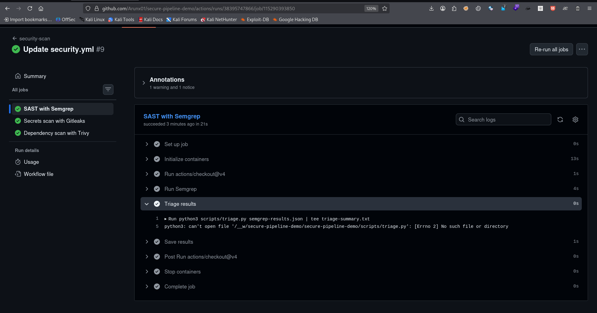

**Symptom:** The triage summary box on the run page was empty, though every job was green.
**Cause (two layers):**
1. `scripts/triage.py` had not been committed to the repository.
2. The step used `python3 ... | tee file`. In a shell pipeline the exit code comes from the **last** command, so `tee` succeeded and hid Python's failure.

**Fix:** Added the script, and removed the pipe, using `> triage-summary.txt` so a failing script now fails the step.

### 4. "No leaks detected" on later runs

**Cause:** On a push, Gitleaks scans only the **new commits**. Later pushes contained no secret, even though the key was still in the repository.
**Takeaway:** A committed secret stays in git history. The correct response is to rotate it, and a clean Gitleaks result on a later push does not prove the history is clean.

### 5. Confirming a green Trivy job really was clean

A green Trivy job only means the tool did not crash. After the fixes I opened the **Run Trivy** log and read the Report Summary table to confirm the dependency count was actually 0.

---

## Design Decisions

| Decision | Reasoning |
|---|---|
| Gate on HIGH only | Blocking on everything creates alert fatigue, and developers start ignoring the pipeline |
| Gate runs after report steps | Reports must be saved even when the build fails |
| Ignore list reports its count | Silent suppression hides risk, and visible suppression stays auditable |
| Custom rule has a negative test | A rule that flags safe code gets disabled by developers |
| Deliberately vulnerable app | Known flaws make it possible to verify that each scanner works |
| Pinned the Trivy action to a verified version | Pipeline dependencies are part of the attack surface |
| Parameterized query for the SQL fix | Fixes the root cause. Escaping or filtering input is weaker |
| Read logs, not just job status | A green job only means the tool ran, not that it found nothing |

---

## Key Lessons

- **A green job does not mean "clean".** A scanner can run successfully and still miss things. I confirmed each tool by reading its logs and testing it against known-bad input.
- **Default rules have gaps.** Custom rules close them, and they must be tested for both false negatives and false positives.
- **Fail loudly.** Silent failures in a security pipeline are dangerous.
- **Deleting a secret is not remediation.** It stays in git history, so rotate it.
- **Pipeline dependencies are an attack surface.** The Trivy tag incident is a reminder to verify and pin action versions.
- **Tools overlap.** Trivy and Gitleaks flagged the same key, and real triage includes deduplicating across tools.
- **Scanner labels can be imprecise.** Semgrep tagged the SQL injection as CWE-704, though the standard classification is CWE-89.
- **Fixing means verifying.** The fix is confirmed when the scanner agrees, not when the code is edited.

---

## Limitations

- This is a personal lab on a small app, not a production system.
- The quality gate currently covers **Semgrep findings only**. Trivy and Gitleaks results are reported but do not block the build.
- Trivy is configured to report **HIGH and CRITICAL only**. "0 vulnerabilities" means none at those levels, and lower-severity issues are hidden by the filter.
- `requests==2.20.0` was left at its original, very old version. It was not flagged at HIGH or CRITICAL, but it is outdated and likely carries lower-severity issues. Upgrading it is a one-line change I have not made.
- Semgrep's free tier hides code snippets in its JSON output, so the triage script reports locations rather than code.
- The original vulnerable code and the fake key remain visible in the commit history, on purpose.
- No DAST or runtime testing was performed.
- GitHub shows deprecation warnings about Node.js 20 and the `ubuntu-latest` label migration. These do not affect results.

---

## Next Steps

- Extend the gate to Trivy CRITICAL findings and Gitleaks
- Lower Trivy's severity threshold to include MEDIUM, and upgrade `requests`
- Enforce the checks on pull requests with branch protection
- Pin all actions to commit SHAs, not version tags
- Add DAST (OWASP ZAP) against a running instance
- Deduplicate findings across tools into a single report
- Generate an SBOM and add software supply chain checks
- Write additional Semgrep rules for framework-specific patterns

---

## How to Reproduce

1. Fork or clone this repo.
2. Push any commit to `main`, or open a pull request.
3. Open the **Actions** tab to watch the three scanners run.
4. Download the `semgrep-results` artifact for the raw JSON and `triage-summary.txt`.

To run the triage script locally:

```bash
python3 scripts/triage.py semgrep-results.json
python3 scripts/triage.py semgrep-results.json --fail-on-high
```

<details>
<summary>Final pipeline definition (security.yml)</summary>

```yaml
name: security-scan

on:
  pull_request:
  push:
    branches: [main]

jobs:
  semgrep:
    name: SAST with Semgrep
    runs-on: ubuntu-latest
    container:
      image: semgrep/semgrep
    steps:
      - uses: actions/checkout@v4
      - name: Run Semgrep
        run: semgrep scan --config p/python --config rules/ --json --output semgrep-results.json
      - name: Triage results
        run: |
          python3 scripts/triage.py semgrep-results.json > triage-summary.txt
          cat triage-summary.txt
          { echo '```'; cat triage-summary.txt; echo '```'; } >> "$GITHUB_STEP_SUMMARY"
      - name: Save results
        uses: actions/upload-artifact@v4
        with:
          name: semgrep-results
          path: |
            semgrep-results.json
            triage-summary.txt
      - name: Quality gate (fail on HIGH findings)
        run: python3 scripts/triage.py semgrep-results.json --fail-on-high

  gitleaks:
    name: Secrets scan with Gitleaks
    runs-on: ubuntu-latest
    steps:
      - uses: actions/checkout@v4
        with:
          fetch-depth: 0
      - uses: gitleaks/gitleaks-action@v2
        env:
          GITHUB_TOKEN: ${{ secrets.GITHUB_TOKEN }}

  trivy:
    name: Dependency scan with Trivy
    runs-on: ubuntu-latest
    steps:
      - uses: actions/checkout@v4
      - uses: aquasecurity/trivy-action@v0.35.0
        with:
          scan-type: fs
          scan-ref: .
          severity: HIGH,CRITICAL
```

</details>

---

## Glossary

| Term | Meaning |
|---|---|
| **CI/CD** | Continuous Integration / Continuous Delivery: automation that builds, tests and ships code on every change |
| **SAST** | Static Application Security Testing: analyzing source code for vulnerabilities without running it |
| **SCA** | Software Composition Analysis: checking third-party libraries for known vulnerabilities |
| **DAST** | Dynamic Application Security Testing: testing a running application from the outside |
| **CVE** | A public identifier for a specific known vulnerability |
| **CWE** | A category of software weakness (for example CWE-89 is SQL injection) |
| **OWASP Top 10** | A widely used list of the most critical web application risks |
| **Shift left** | Moving security checks earlier in the development process |
| **Quality gate** | A rule that blocks a build or merge when a condition is not met |
| **False positive** | A finding reported by a tool that is not actually exploitable |
| **Metavariable** | A placeholder in a Semgrep pattern (like `$NAME`) that matches any code at that position |
| **SARIF** | A standard file format for static analysis results |
| **Secret rotation** | Revoking a leaked credential and issuing a new one |
